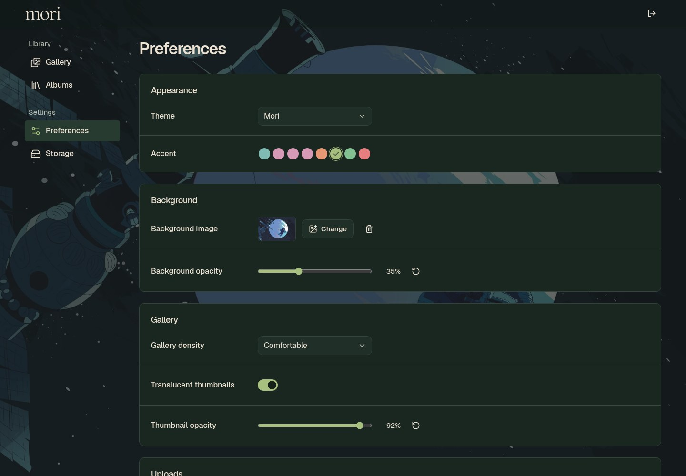

# Mori

**Your media, beautifully organized. Surprisingly light on memory.**

Mori gives your images and videos a home of their own. Browse your collection, organize it into albums, and share exactly what you choose—all through a clean, personal gallery.

[Live site](https://media.laplacian.net) · [Get started](#deploy) · [License](LICENSE)


## Features

- **One gallery for everything.** Keep images and videos together, search your collection, and browse comfortably on a desktop or phone.
- **Share in seconds.** Copy a link to an image, video, or album. Want a video on another website? Its ready-to-copy embed code is a click away.
- **Privacy you control.** Keep media and albums private, or make them available to anyone with the link. Your homepage never exposes your collection.
- **Uploads at your pace.** Preview your selection, add or remove files, upload several at once, and pause, resume, or cancel along the way.
- **Less organizing, more enjoying.** Select several files to move them between albums, remove them from an album, or delete them together.
- **Smaller uploads, your choice.** Choose Balanced, Higher quality, or Keep originals. Supported files can be optimized before uploading; when that would not help, Mori keeps the original.
- **A look that feels yours.** Choose Mori, Catppuccin, or Tokyo Night colors, add your own background, and adjust how much it shows through the gallery.
- **A small appetite for memory.** Our live library of 16 media files used about **7 MB of server memory while idle** and **28 MB while browsing and opening images** in a short check on November 6, 2026. Usage varies with activity.

## Make it yours

Pick a background you love, tune its opacity, and give your thumbnails a little transparency. Appearance settings stay in your browser.



## Take a closer look

Open an image to zoom, drag, and explore. Move through your collection with the keyboard, go fullscreen, or download a file to keep.


<details>
<summary>On your phone</summary>

<p align="center">
  
</p>

</details>

## License

Mori is open source under [AGPL-3.0-or-later](LICENSE). See [NOTICE](NOTICE) for licensing details and third-party notices.

## Deploy

Run Mori on your own Linux server with Docker Compose. You will need a private Amazon S3 bucket for your media and an HTTPS domain. Published images currently support 64-bit Intel/AMD servers. There is no need to download the source code or build the app yourself.

### 1. Get the configuration

```sh
mkdir mori
cd mori
curl -fsSLO https://raw.githubusercontent.com/Cubeyond/mori/main/compose.yml
curl -fsSL https://raw.githubusercontent.com/Cubeyond/mori/main/.env.example -o .env
chmod 600 .env
```

Edit `.env`: set `MORI_PUBLIC_URL` to your exact HTTPS origin and replace `MORI_ADMIN_PASSWORD` with a unique random password of at least 12 characters. The default username is `root`.

```dotenv
MORI_PUBLIC_URL=https://media.example.com
MORI_ADMIN_USERNAME=root
MORI_ADMIN_PASSWORD=replace-with-a-long-random-password
```

Then start Mori:

```sh
docker compose up -d --pull always
```

The default listener is `127.0.0.1:3000`. For a local-only trial, set `MORI_PUBLIC_URL=http://localhost:3000` and open that address.

### 2. Put HTTPS in front

Use your existing Caddy or another reverse proxy. Caddy is managed separately from Mori's Compose file.

For Caddy running on the host:

```caddyfile
media.example.com {
    reverse_proxy 127.0.0.1:3000
}
```

For Caddy running in another container, attach that container to Mori's Docker network (named `mori` by default) and use `reverse_proxy mori:3000` instead. Point the domain's DNS at your server before obtaining its certificate.

### 3. Connect Amazon S3

1. Create a private, general-purpose S3 bucket with **Block Public Access** enabled.
2. Create a dedicated AWS access key with the [example access policy](examples/s3/iam-policy.json). Replace `YOUR_BUCKET_NAME` with your complete bucket name.
3. Apply the [upload CORS example](examples/s3/cors.json), replacing `https://media.example.com` with your exact `MORI_PUBLIC_URL` origin. See [AWS's CORS documentation](https://docs.aws.amazon.com/AmazonS3/latest/userguide/ManageCorsUsing.html).
4. Log in to Mori and open **Settings → Storage**. Enter the bucket name, region, Access key ID, and Secret access key. Leave Session token empty for ordinary IAM user keys, and leave Distribution ID empty when not using CloudFront. Test the connection, then save.

Mori saves your S3 connection securely in its data volume. Your server and Amazon S3 usage are billed by their providers. CloudFront is optional. For AWS cleanup and encryption options, see the [S3 setup notes](examples/s3/README.md).

### Updates and backups

Pull and run the newest published image:

```sh
docker compose up -d --pull always
```

Keep the `metadata` data volume when updating. Back up both this volume and your S3 bucket: Mori needs its saved library information and encryption key to restore your connection.

The default upload limits are **1 GB per video** and **100 MiB per image**. You can change them in your `.env` file. Mori currently supports a single administrator; images and videos are stored in Amazon S3.
