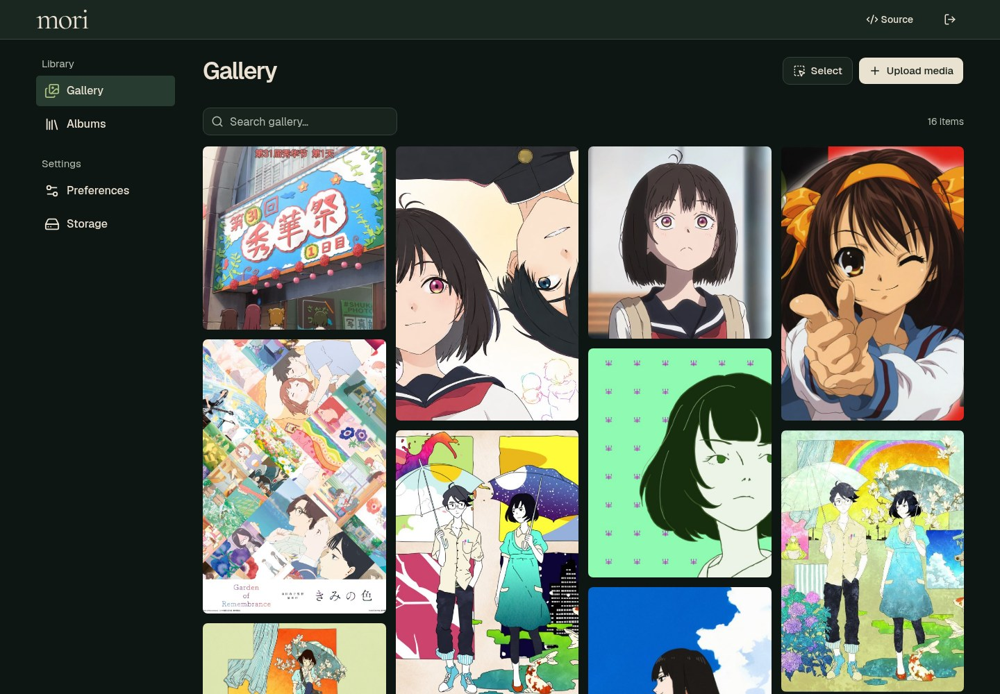
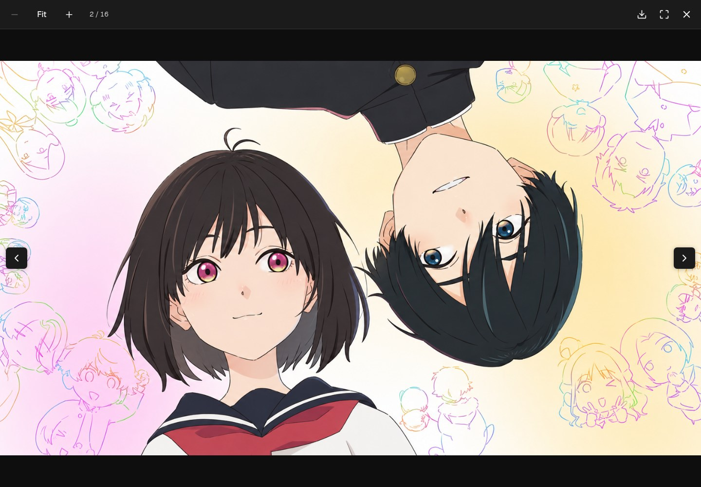
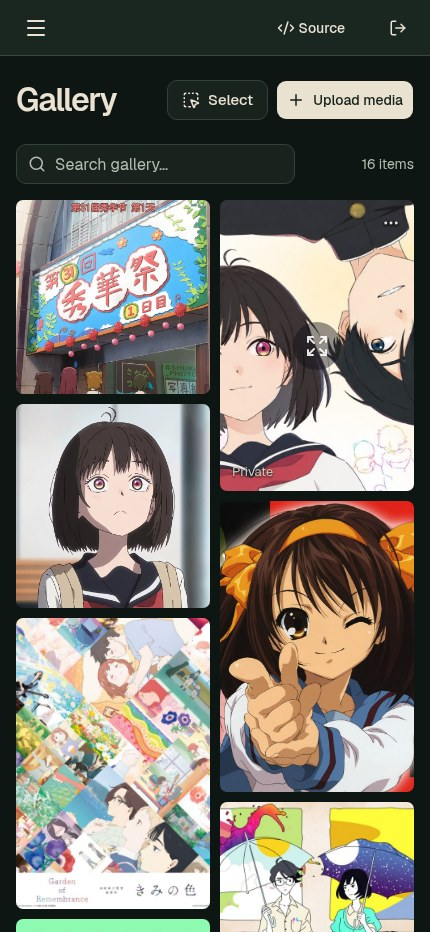

# Mori

**A rich media library. A surprisingly small stack.**

Mori is a lightweight, self-hosted home for images and videos. A Rust backend, a static SvelteKit interface, SQLite metadata, and your own Amazon S3 bucket—all behind one container.

[Live site](https://media.laplacian.net) · [Container image](https://github.com/orgs/Cubeyond/packages/container/package/mori) · [AGPL-3.0-or-later](LICENSE)



## Made for your media

- **Images and videos, together.** A compact, responsive masonry gallery with search, quiet hover controls, and full-size previews that preserve the original aspect ratio.
- **Share on your own domain.** Copy a direct media link or a video's iframe code. Album members use `/<album-slug>/<random-name>.<ext>`; standalone media uses `/file/<random-name>.<ext>`.
- **Public when you choose.** Albums and individual media have independent public/private settings. Visitors see shared content; the homepage never lists your library.
- **A real upload queue.** Thumbnail previews, add/remove files before uploading, concurrent multipart uploads, pause, resume, and cancel. Media parts travel directly from your browser to S3.
- **Less busywork.** Select multiple items to move into an album, remove from an album, delete, or create an album and move them together.
- **Your own atmosphere.** The forest-green Mori theme, Catppuccin and Tokyo Night, accent colors, and browser-local background preferences.

Upload optimization runs in your browser, with **Balanced**, **Higher quality**, and **Keep originals** presets. Supported conversions aim to reduce size; unsupported or unhelpful conversions keep the original. The server does not transcode videos.

## Take a closer look

The lightbox supports wheel zoom, dragging, keyboard navigation, fullscreen, and downloads. Its neutral background keeps the focus on the image.



<details>
<summary>Same library, smaller screen</summary>

<p align="center">
  
</p>

</details>

These are screenshots of the administrator view on [media.laplacian.net](https://media.laplacian.net), not mockups. The media shown is user-supplied; underlying artwork retains its creators' rights.

## Small by design

| Component                             | Role                                                             |
| ------------------------------------- | ---------------------------------------------------------------- |
| Rust + Axum                           | API, authorization, media streaming, and durable background jobs |
| SvelteKit + TypeScript + Tailwind CSS | Static frontend; no Node.js server in production                 |
| SQLite                                | Metadata, sessions, and job state in one persistent volume       |
| Amazon S3                             | Media originals and previews; no local-media storage adapter     |

The default Compose configuration gives Mori a **256 MiB memory budget** and runs it as a non-root user with a read-only filesystem. Thumbnail generation and upload optimization happen in the browser.

Mori currently has one administrator. Browser preview and playback depend on the file format and codec; other allowed formats remain downloadable. Without CloudFront, Mori streams downloads from S3, so media delivery uses your server's bandwidth. CloudFront is optional.

The HTTP API lives under `/v1/*`; its generated contract is available at `/v1/openapi.yml` and in [api/openapi.yml](api/openapi.yml).

## License

Mori is licensed under [AGPL-3.0-or-later](LICENSE). Commercial use is allowed; modified versions offered over a network must provide corresponding source as required by the license. Each official image's **Source** link points to its exact public Git commit. Modified distributions can set `MORI_SOURCE_URL` to their corresponding source.

Third-party code and assets retain their own licenses; see [NOTICE](NOTICE) and [dependency notices](licenses/README.md).

## Deploy

You need Docker with Compose, a **Linux x86-64** host, and a private Amazon S3 bucket. Production also needs an HTTPS reverse proxy. The public GHCR image requires no registry login, source checkout, or compilation on your server.

### 1. Get the configuration

```sh
mkdir mori
cd mori
curl -fsSLO https://raw.githubusercontent.com/Cubeyond/mori/main/compose.yml
curl -fsSL https://raw.githubusercontent.com/Cubeyond/mori/main/.env.example -o .env
chmod 600 .env
```

Edit `.env`: set `MORI_PUBLIC_URL` to your exact HTTPS origin and replace `MORI_ADMIN_PASSWORD` with a unique random password of at least 12 characters. The default username is `root`.

```dotenv
MORI_PUBLIC_URL=https://media.example.com
MORI_ADMIN_USERNAME=root
MORI_ADMIN_PASSWORD=replace-with-a-long-random-password
```

Then start Mori:

```sh
docker compose up -d --pull always
```

The default listener is `127.0.0.1:3000`. For a local-only trial, set `MORI_PUBLIC_URL=http://localhost:3000` and open that address.

### 2. Put HTTPS in front

Use your existing Caddy or another reverse proxy. Caddy is managed separately from Mori's Compose file.

For Caddy running on the host:

```caddyfile
media.example.com {
    reverse_proxy 127.0.0.1:3000
}
```

For Caddy running in another container, attach that container to Mori's Docker network (named `mori` by default) and use `reverse_proxy mori:3000` instead. Point the domain's DNS at your server before obtaining its certificate.

### 3. Connect Amazon S3

1. Create a private, general-purpose S3 bucket with **Block Public Access** enabled.
2. Give a dedicated IAM identity access to Mori's objects using the [example policy](examples/s3/iam-policy.json). Replace `YOUR_BUCKET_NAME` with the complete bucket name, including any AWS account/region suffix. This example assumes S3-managed encryption; customer-managed KMS keys need additional KMS permissions.
3. Apply the [upload CORS example](examples/s3/cors.json), replacing `https://media.example.com` with your exact `MORI_PUBLIC_URL` origin. See [AWS's CORS documentation](https://docs.aws.amazon.com/AmazonS3/latest/userguide/ManageCorsUsing.html).
4. Log in to Mori and open **Settings → Storage**. Enter the bucket name, region, Access key ID, and Secret access key. Leave Session token empty for ordinary IAM user keys, and leave Distribution ID empty when not using CloudFront. Test the connection, then save.

S3 credentials are stored encrypted in the persistent volume, rather than in Compose. AWS storage, request, and transfer charges are separate from hosting Mori. An [incomplete multipart upload lifecycle rule](https://docs.aws.amazon.com/AmazonS3/latest/userguide/mpuoverview.html) can clean up abandoned parts.

### Updates and backups

Pull and run the newest published image:

```sh
docker compose up -d --pull always
```

For a fixed version, set `MORI_IMAGE=ghcr.io/cubeyond/mori:sha-<full-commit-sha>` in `.env`. Keep the named `metadata` volume when updating, and back up both the volume and your S3 objects. The volume contains SQLite metadata and `storage.key`; both are needed to restore the saved S3 configuration.

Optional environment settings in [.env.example](.env.example) include separate video and image upload limits. Defaults are **1 GB per video** and **100 MiB per image**. Allowed extensions can be configured through `MORI_VIDEO_EXTENSIONS` and `MORI_IMAGE_EXTENSIONS`.
